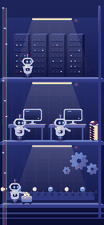

# СберKids · Слой пасхалок

**Трек A «Приколы» · HSE × Sber Mobile Hack 2026**

В приложении спрятано 5 секретов. Ребёнок находит первый (трясёт телефон на главном — летят мыльные пузыри), получает «Пасхалка найдена! 1 из 5» и загадку, где искать следующий. Каждая находка — короткий эффект поверх интерфейса, который не мешает пользоваться приложением, и подсказка-загадка к следующей. Всё содержимое — эффекты, тексты, расписание, веса, триггеры — приезжает JSON-конфигом с CDN без релиза.

| # | Пасхалка | Где | Как вызвать | Что происходит |
|---|----------|-----|-------------|----------------|
| 1 | Мыльные пузыри | Главный | Потрясти телефон | 22 радужных пузыря поднимаются поверх экрана, их можно лопать |
| 2 | Обезьянка-паркурщик | Контент | Потянуть ленту вниз и подержать | Сверху падает банан, обезьяна прыгает от края экрана, делает сальто и ловит его |
| 3 | Призраки в тумане | Профиль | Зажать свою аватарку и держать 5 секунд (случайно так никто не держит; первую секунду ничего не видно) | Вокруг пальца сгущается туман, на каждой секунде лёгкий «тук», из тумана выглядывают глазки — и вылетают добрые призраки: следят глазами за пальцем и с низким «у-у-у» тают от касания |
| 4 | Цех роботов | Настройки | 7 быстрых нажатий на «Версия приложения» (как режим разработчика) | Интерфейс механически отъезжает вбок — внутри трёхэтажный цех: серверы, кабели с данными, роботы печатают код и везут монетки. Робот замечает ребёнка, катится к красной кнопке — сирена, интерфейс со свистом влетает обратно и бьётся о край экрана |

<p align="center"> </p>

## Почему это ложится в СберKids

- **Слой поверх, а не экран на пути.** Отдельное прозрачное окно над приложением. Касания проходят насквозь, кроме попавших в пузырь/призрака. Эффект живёт 4–8 секунд.
- **Экраны с деньгами защищены в коде.** Перевод, оплата, реквизиты, лимиты — в `ScreenPolicy.sensitive`. Конфиг не может это переопределить. Переход на такой экран мгновенно гасит эффект, тост и шторку.
- **Никакого бэкенда.** Конфиг — «новый ключ в CMS» (здесь — статический JSON на CDN), ресурсы — статика по https, прогресс — локально на устройстве.
- **Ноль новых зависимостей и разрешений.** Lottie (уже в стеке), SwiftUI Canvas / Compose Canvas, CoreMotion / SensorManager, системные касания. Ни одного запроса разрешений.
- **Одна логика на обе платформы.** Ядро (`FunLayerCore`) — чистый Swift без UIKit; переносится на Kotlin построчно (см. [docs/ANDROID_PORTING.md](docs/ANDROID_PORTING.md)). Контент — один и тот же JSON и те же файлы.
- **Интеграция — по строке в существующих обработчиках:** `install(on:)`, `setScreen(_:)`, `reportPull(distance:)` из ленты, `reportTap(_:)` из нажатия на «Версию», `reportHold(_:_:at:)` из long-press на аватарке.

## Что меняется без релиза

| Что | Где в конфиге |
|-----|---------------|
| Включить/выключить весь слой (рубильник) | `enabled` |
| Набор пасхалок, их порядок, экраны | `eggs[].order`, `eggs[].screen` |
| Триггер и его чувствительность | `eggs[].trigger` (`shake`/`pullHold`/`hold`/`tapSequence`, есть `palm`/`faceDownFlip`/`circles`) |
| Эффект: частицы, Lottie, туман, призраки — любые комбинации | `eggs[].variants[].effect.layers[]` |
| Внешний вид: спрайты, персонажи, цвета, количество, скорость | `assets`, параметры слоёв |
| Сезонность и расписание | `eggs[].schedule` (`from`, `to`, `months`) |
| Вероятности вариантов (например, редкие золотые пузыри) | `variants[].weight` |
| Все тексты, загадки, подсказки, пиктограммы | `texts`, `eggs[].hint` |
| Тизер для первой находки | `teaser` |
| Звуки и вибрация | `sound`, `interactSound`, `haptic` |
| Сколько секретов «объявлено» (1 из 5) | `announcedTotal` |

В репозитории 4 готовых конфига — [осень](cdn/fun-layer/v1/config.json), [зима](cdn/fun-layer/v1/config-winter.json) (снег вместо пузырей, «снежные духи»), [праздник](cdn/fun-layer/v1/config-party.json) (золотые пузыри 50%, турбо-обезьяна), [рубильник](cdn/fun-layer/v1/config-off.json). Переключаются в скрытом меню прямо на демо.

## Надёжность

- Битый, пустой или неизвестной версии JSON — слой молча продолжает работать на предыдущем конфиге (или выключается). Тесты: `ConfigTests`.
- Неизвестный тип слоя/триггера пропускается точечно — старое приложение читает новый конфиг.
- Жёсткие ограничители в коде: ≤ 40 частиц, ≤ 6 призраков, эффект ≤ 10 с, затемнение ≤ 35 %, ресурсы ≤ 6 МБ.
- Ресурсы проверяются по sha256; новый конфиг включается только когда скачаны все его файлы.
- Ссылки в тексте шаринга вырезаются, ресурсы — только https.

## Бюджеты

| Показатель | Бюджет ТЗ | У нас |
|------------|-----------|-------|
| Запуск и главный экран | без замедления | сеть на старте не трогаем; CDN — через 2 с после показа главного |
| Плавность | 60 fps | Lottie на Core Animation; Canvas рисует ≤ 40 готовых спрайтов; после эффекта цикл кадров уничтожается |
| Вес ресурсов прикола | ≤ 6 МБ | ~0,7 МБ на весь конфиг (пузыри 2×130 КБ, обезьяна 177 КБ Lottie, туман 28 КБ, звуки) |
| Прирост сборки | ≤ 3 МБ | ~0,8 МБ встроенных копий + код модуля; Lottie уже в приложении |
| Датчики | — | включаются только на экране, где есть пасхалка, и только пока приложение активно |

## Структура

```
cdn/fun-layer/v1/           ← то, что лежит на CDN (GitHub Pages для демо)
  config*.json               конфиги-пресеты
  assets/                    спрайты, Lottie, звуки
ios/
  FunLayerCore/              ядро: конфиг, валидация, детекторы жестов, движок, физика (+29 тестов)
  SberKidsFun/
    FunLayer/                модуль для приложения: окно-оверлей, рендеринг, датчики, тост, шторка
    Shell/                   оболочка СберKids для демо: экраны 1:1 из макетов Figma организаторов
    ShellAssets/             нарезка макетов (tools/build_shell_assets.py) — в продукт не входит
    FunLayerDefaults/        встроенные копии CDN (офлайн и защита от битого CDN)
  SberKidsFun.xcodeproj
android/funlayer-core/       перенос ядра на Kotlin (справочная реализация)
tools/                       генераторы ассетов, Lottie-обезьяны и сборка CDN
docs/                        архитектура, формат конфига, Android, педагогика, сценарий демо
```

## Запуск

```bash
open ios/SberKidsFun.xcodeproj
```

Xcode 26, iOS 15+. Выберите свою команду в Signing & Capabilities, запустите на iPhone (тряска проверяется только на устройстве; в симуляторе — Device → Shake и меню разработчика).

**Скрытое меню**: Профиль (аватар на главном) → вкладка «Настройки» → долгое нажатие на «Версия приложения» внизу. Там пресеты конфигов, загрузка с CDN, ручной запуск пасхалок, сброс прогресса, калибровка ладони.

Тесты ядра:

```bash
cd ios/FunLayerCore && swift test
```

UI-тесты настоящими жестами на подключённом iPhone — удержание аватарки (короткое нажатие не срабатывает, 5 секунд — призраки) и «потянуть ленту и не отпускать» (обезьянка доигрывает до конца):

```bash
cd ios && xcodebuild test -project SberKidsFun.xcodeproj -scheme SberKidsFun -destination 'platform=iOS,id=<UDID>' -allowProvisioningUpdates
```

Оболочка приложения собрана из экспорта Figma (PNG 2x) один в один: экраны — картинки макетов, кнопки — зоны нажатия поверх них, таб-бар закреплён, лента «Контента» прокручивается и тянется. Пересобрать после изменений в макете:

```bash
python3 tools/build_shell_assets.py ~/Downloads/sberkids-figma
```

Пересобрать ассеты и CDN:

```bash
python3 tools/gen_assets.py && python3 tools/make_monkey_lottie.py && python3 tools/build_cdn.py
```

## Документы

- [Архитектура и внедрение](docs/ARCHITECTURE.md)
- [Формат конфига](docs/CONFIG.md)
- [Перенос на Android](docs/ANDROID_PORTING.md)
- [Педагогика, безопасность, модель вероятностей](docs/PEDAGOGY.md)
- [Сценарий демо на защите](docs/DEMO.md)
